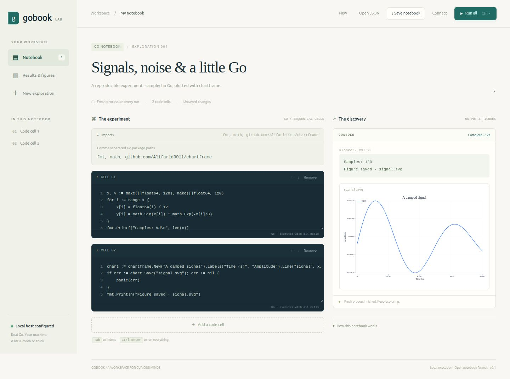

# GoBook

A small computational notebook for Go. Write editable cells in your browser, run them with the real Go compiler, and keep notes, output, and chart images together. The server and UI use the Go standard library; there is no Python runtime, CDN, telemetry, or AI service.

**Status: early MVP.** GoBook currently computes Go code. NotebookLM-style document sources, retrieval, and AI Q&A are future work and are not implemented.



## Start

Install Go 1.25 or newer:

```sh
go install github.com/Alifarid0011/gobook@v0.1.0
gobook
```

Or run from a source checkout:

```sh
go run .
```

Open the local capability URL printed in the terminal. Keep it private: it authorizes code execution. GoBook listens only on `127.0.0.1`; it refuses other bind addresses. A free port is available with `go run . -addr 127.0.0.1:0`.

For a reusable executable:

```sh
go build -o gobook .
./gobook
```

The browser layout adapts to small screens. The Go compiler and server run on a Go-enabled host; this is not a native phone application.

| Capability | Current scope |
| --- | --- |
| Native computation | Go 1.25+ compiler on the host |
| Browser UI | Responsive HTML/CSS/JavaScript; no external assets |
| Linux | Build and kernel/API tests verified locally |
| macOS / Windows | Cross-compilation verified for Windows amd64 and macOS arm64; runtime behavior not verified locally |
| Mobile / tablets | Browser client through a user-managed HTTPS reverse proxy; Go runs on the host |
| Install | Local executable plus web app manifest; browser installation support varies |
| AI / source Q&A | Not implemented; no backend connected |

## Use

1. Give the notebook a title and note.
2. List package imports, separated by commas. Use package paths without aliases.
3. Write Go statements in cells, then choose **Run all**.
4. Save JSON in your browser; **Open JSON** loads a notebook without running it.

Use Ctrl/Cmd+Enter to run all cells. Tab indents code; Shift+Tab moves keyboard
focus out of the editor. Cell arrows reorder execution. Editing during a run
keeps its output tied to the earlier source snapshot.

All code cells are concatenated inside one `func main()`. Variables declared in an earlier cell are available below it. Imports belong in the explicit imports field; top-level function/type declarations can be written as local function values/types where Go permits. Standard Go compile rules apply, including unused imports. Build errors identify `cell1.go`, `cell2.go`, and so on.

Every run compiles and launches a fresh process in a fresh temporary working directory. **Run all repeats every cell and every side effect.** There is no persistent kernel, partial execution, interrupt button, dependency editor, or live streaming output in this MVP. JSON stores source and notes; output is transient and is not saved in the notebook.

### Charts and numerical packages

Clone [chartframe](https://github.com/Alifarid0011/chartframe) beside GoBook, or select its local module directory:

```sh
go run . -chartframe /absolute/path/to/chartframe
```

The default lookup is `../chartframe` relative to the launch directory. Open `examples/sine.gobook.json` to sample a sine function and render SVG. GoBook displays regular `.svg` and `.png` files from the run directory as images. Files are collected only from the directory's top level. Use ordinary relative filenames, for example `sine.svg`.

Imports under `gonum.org/v1/gonum/` add Gonum v0.17.0 to the temporary module. chartframe uses v0.1.0 unless a local module replacement is configured. Module downloads use the host's Go module cache/network configuration; a first run can take longer. Other third-party modules are outside the current dependency setup.

`examples/simulation.gobook.json` runs a reproducible Monte Carlo experiment with a fixed random seed. Its timing excludes compilation and makes no cross-language performance claim.

## Trust and limits

**Execute only code you trust. Notebook code has your full user permissions**, including access to files, environment credentials, subprocesses, and the network. A temporary working directory is not a security sandbox. The HTTP guards protect the local control endpoint; they do not restrict code that you choose to run.

The server checks the exact listening Host, rejects cross-origin requests, and requires a random bearer capability for execution. The private capability URL enables execution; the page keeps the token in tab session storage and removes it from the address bar. The static page shell itself is public on loopback and cannot execute code without the capability. The capability grants full host code execution. Share it only with people you trust to run code on that host. Keep the default loopback setup unless you intentionally configure the HTTPS proxy described below.

Execution is serial (another run receives HTTP 409). Requests are capped at 256 KiB. Captured stdout and stderr share a 1 MiB budget; further output is discarded and marked truncated. Build timeout is 60 seconds, execution timeout is 30 seconds, with `GOMAXPROCS=2` and compiler `-p 2`. These reduce normal resource use; they are not CPU/memory/disk security quotas. POSIX process groups are killed on timeout and after execution; code can deliberately escape this mechanism. Windows tree termination uses `taskkill` and remains unverified locally.

Up to 16 images and 8 MiB total are returned per run. Non-regular files and symlinks are skipped. Images use data URLs in `` elements; SVG and notebook output are never inserted as active HTML. There is no arbitrary filesystem browsing API. Temporary run files are removed after collection.

## Other devices and browser installation

For a phone or another computer, keep the kernel on a Go-enabled host and configure your own HTTPS reverse proxy (with a valid trusted certificate) forwarding to the loopback listener:

```sh
go run . -addr 127.0.0.1:8080 -public-origin https://book.example
```

Replace `book.example` with the exact host you control. The proxy must preserve the public `Host` and browser `Origin` headers and forward to `127.0.0.1:8080` on the same host. Configure proxy timeouts to allow a 90-second build/run request. `-public-origin` accepts one HTTPS origin, without a path, credentials, query, or fragment; it does not set up DNS, certificates, authentication at the proxy, or networking for you. Forwarded headers are not trusted. Direct listening remains loopback-only, even in this mode. Keep the private capability URL secret and avoid access logs that record its query string.

Open the printed proxy capability URL on the other device. The browser executes only the interface; all Go code still runs with full permissions on the host. The header's **Connect** action accepts that private URL or token when starting a new installed-app session. Capabilities live for the server process lifetime and must be entered again after a restart.

A manifest and SVG icon let supporting browsers offer **Install app** or their own add-to-home-screen flow. The install button appears when the browser supplies an installation prompt. HTTPS (or localhost) is required. Installation support varies across browsers and operating systems; native mobile execution is not provided. No service worker or offline cache is installed. Execution requires the host and proxy to be running and reachable; notebook source and API requests are never cached by a service worker.

## Development

```sh
go test -p 2 ./...
go vet ./...
go build ./...
```

Tests exercise real compilation, syntax errors, bounded output, timeouts, artifact handling, imports, JSON round trips, and API request guards. CI is configured for Go 1.25 on Linux, macOS, and Windows; configured jobs are not evidence that those jobs have run.

MIT license · alifarid
